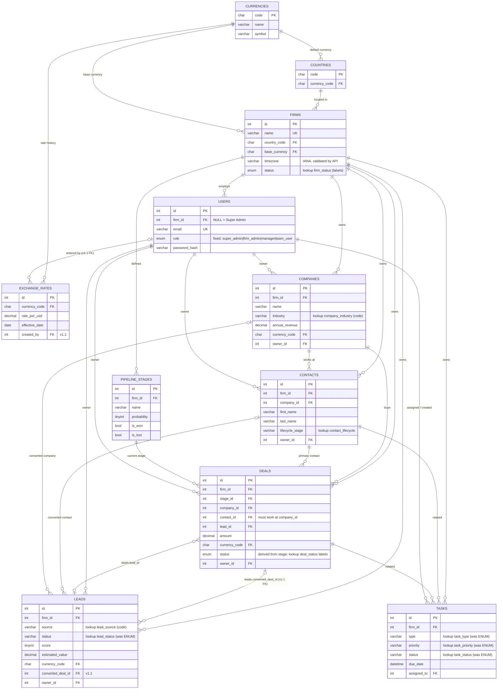
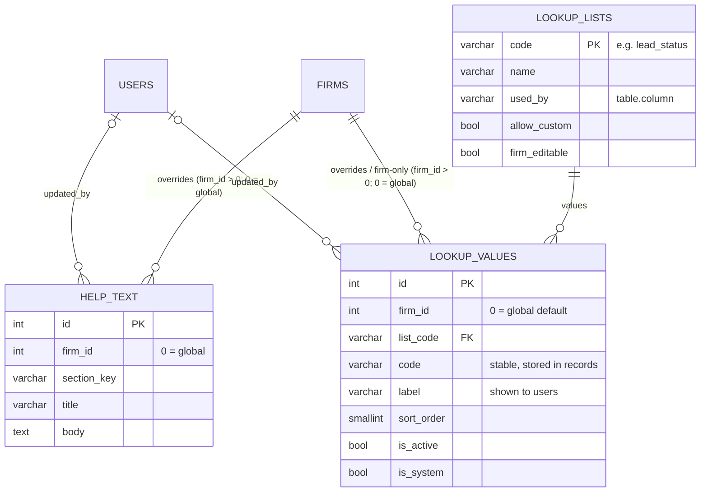
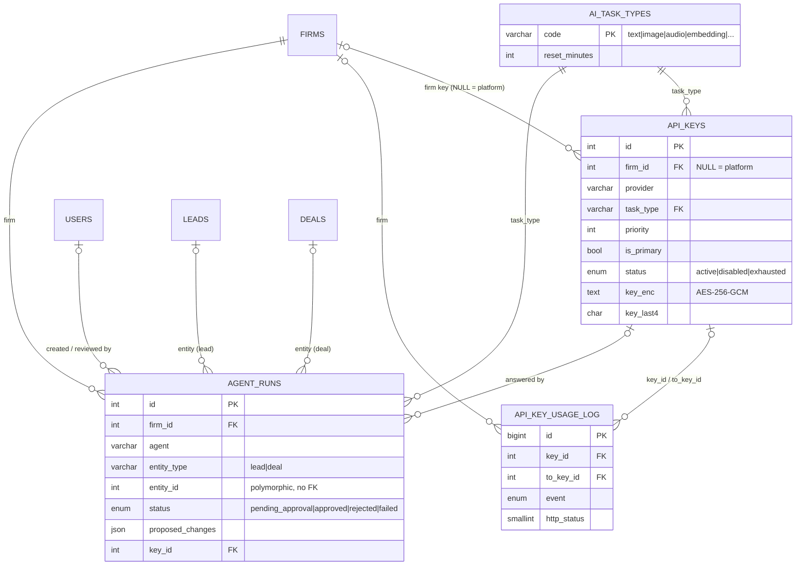

# NCLC CRM — Entity-Relationship Diagram

> **Document:** ER Diagram v1.1 · **Last updated:** 2026-11-21 14:25 IST (UTC+05:30) · **Field-level mapping:** [Data_Relationships.md](Data_Relationships.md)

Rendered with Mermaid (GitHub, VS Code with a Mermaid extension, or https://mermaid.live). Generated from the live database inspection (18 tables, 50 foreign keys). v1.1 adds the AI tables, dropdown tables, and the foreign keys `leads.converted_deal_id → deals` and `exchange_rates.created_by → users`.

## 1. CRM core

## 2. Configuration: help text and dropdown values

`UNIQUE (firm_id, list_code, code)`. The firm_id → FIRMS line is logical: `0` is a sentinel, so there is no database FK (see Data_Relationships §2).

## 3. AI: keys, usage, agents

## Tenant boundary
Everything below `FIRMS` carries `firm_id`. Shared by all firms: `CURRENCIES`, `COUNTRIES`, `EXCHANGE_RATES`, `AI_TASK_TYPES`, `LOOKUP_LISTS`, global help and dropdown rows (`firm_id = 0`), and platform API keys (`firm_id NULL`).
