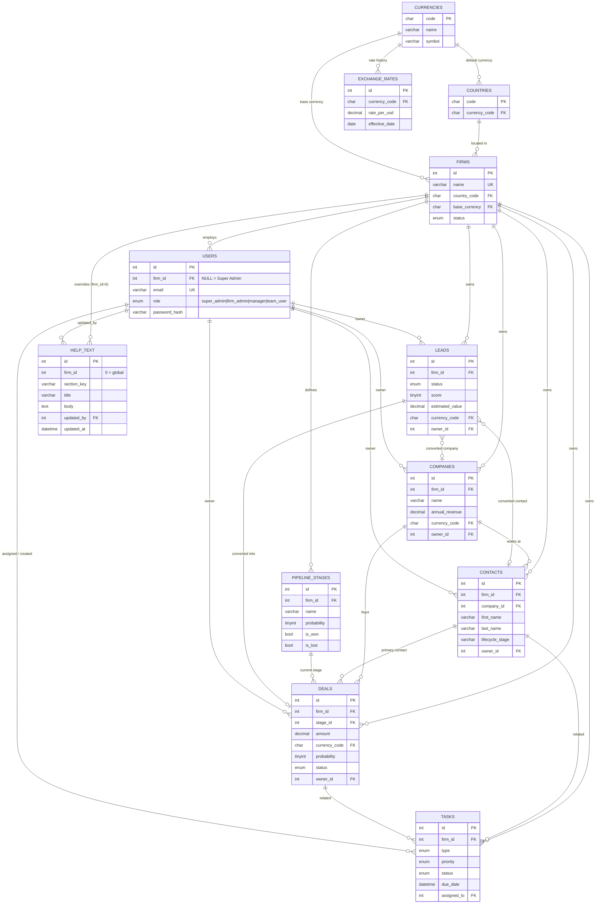

# NCLC CRM — Entity-Relationship Diagram

> **Document:** ER Diagram v1.0 · **Last updated:** 2026-11-21 01:58 IST (UTC+05:30)

Rendered with Mermaid (GitHub, VS Code with a Mermaid extension, or https://mermaid.live).

## Tenant boundary
Everything below `FIRMS` in the diagram carries `firm_id`. The global reference tables (`CURRENCIES`, `COUNTRIES`, `EXCHANGE_RATES`) and global help rows (`firm_id = 0`) are shared by all firms.
